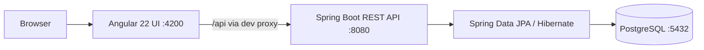

# ProjectFlow — Project & Task Management System

> A full-stack demo application for organizing projects, categorizing tasks, tracking progress, and reviewing work from a data-driven dashboard.

**Stack:** Angular 22 · TypeScript · Spring Boot 4.1.1 · Java 17 · Spring Data JPA · PostgreSQL · Maven

## Overview

ProjectFlow brings together three core resources—**Projects**, **Task Categories**, and **Tasks**—in a responsive management interface. It provides separate list and create/edit views, filters, detail dialogs, validation, and an overview dashboard. The frontend consumes a REST API implemented in Spring Boot, with PostgreSQL persistence.

**Scope:** This is a local-development/demo project, not a deployed multi-user production service. Authentication, authorization, CI/CD, containerization, and production deployment are **not implemented** in the reviewed source.

## Features

- **Dashboard:** live project/category/task statistics; project and task-status filters; completion rate; recent tasks/projects; upcoming deadlines and overdue count.
- **Projects:** create, list, search/filter, edit, delete; unique project code, status, dates and description; full details dialog.
- **Tasks:** create, list, keyword/project/status/priority filtering, paginated API, edit, delete; task priority, status, due date, linked project/category; full details dialog.
- **Categories:** create, list, search, edit, delete; unique category names and descriptions.
- **User experience:** responsive sidebar/navigation, dedicated create/edit URLs, icon actions, confirmation before destructive operations, reactive forms, validation feedback and API error handling.
- **Backend:** REST controllers, DTOs, service/repository layers, Jakarta Bean Validation, global exception responses and database constraints.

## Architecture



**Key design choices:** Angular standalone components, lazy-loaded routes, Signals and Reactive Forms; Spring Boot Controller → Service → Repository → Entity; request/response DTOs; relational task-to-project and task-to-category links.

See [Architecture](docs/ARCHITECTURE.md) and [API Reference](docs/API.md).

## Technology requirements

| Tool | Source-backed version / requirement |
|---|---|
| Java | 17 (Maven `pom.xml`) |
| Spring Boot | 4.1.1 |
| Angular | 22.2.x (`package.json`) |
| Node.js | Compatible with Angular 22; Node 24 LTS was used during development |
| npm | Project declares npm 10.9.9 |
| PostgreSQL | PostgreSQL 18 was used during development; compatible supported versions may work |
| Maven | Maven installation or Maven Wrapper if present locally |
| OS | Ubuntu/Linux commands shown below |

## Repository layout

```text
project-task-management/
├── backend/
│   └── taskmanagement/
│       ├── pom.xml
│       └── src/
│           ├── main/java/com/orange/taskmanagement/
│           │   ├── controller/
│           │   ├── service/
│           │   ├── repository/
│           │   ├── entity/
│           │   ├── dto/
│           │   ├── enums/
│           │   └── exception/
│           └── main/resources/application.properties
├── frontend/
│   └── taskmanagement-ui/
│       ├── angular.json
│       ├── proxy.conf.json
│       ├── package.json
│       └── src/app/
│           ├── core/services/
│           ├── models/
│           ├── features/dashboard/
│           ├── features/projects/
│           ├── features/tasks/
│           └── features/categories/
├── docs/
└── README.md
```

## Quick start (Ubuntu)

> Run these commands from the cloned repository. The paths below are relative to the repository root, so they work on other machines too.

**1. Check prerequisites**

```bash
java -version
node -v
npm -v
mvn -version
pg_lsclusters
```

**2. Configure PostgreSQL**

The current backend expects:

```properties
spring.datasource.url=jdbc:postgresql://localhost:5432/task_management
spring.datasource.username=taskmanager
spring.datasource.password=<your-local-password>
```

Create the role/database if they do not exist:

```bash
sudo systemctl start postgresql
sudo -u postgres psql
```

In the `psql` prompt, choose your own password:

```sql
CREATE ROLE taskmanager WITH LOGIN PASSWORD 'CHOOSE_A_LOCAL_PASSWORD';
CREATE DATABASE task_management OWNER taskmanager;
\q
```

Then edit `backend/taskmanagement/src/main/resources/application.properties` to match your local password. **Do not commit real credentials.** If the role/database already exist, skip creation and use their existing credentials. Hibernate's current `ddl-auto=update` setting creates/updates tables when the backend connects successfully; no separate SQL schema file was present in the reviewed source.

**3. Run backend (Terminal 1)**

```bash
cd backend/taskmanagement
mvn spring-boot:run
```

If your checkout contains an executable `mvnw` wrapper, `./mvnw spring-boot:run` is also valid. Wait for the server to start on **http://localhost:8080**.

**4. Run frontend (Terminal 2, from repository root)**

```bash
cd frontend/taskmanagement-ui
npm install
npx ng serve --proxy-config proxy.conf.json
```

Open **http://localhost:4200/dashboard**. The development proxy forwards `/api/**` to `http://localhost:8080`.

**5. Check API**

```bash
curl -i http://localhost:8080/api/projects
curl -i http://localhost:8080/api/task-categories
curl -i 'http://localhost:8080/api/tasks?page=0&size=5'
```

See the complete [Setup and Run Guide](docs/SETUP.md), including first-run and daily commands.

## Application routes

| URL | Purpose |
|---|---|
| `/dashboard` | Overview and filters |
| `/projects` | Project list |
| `/projects/new` | Create project |
| `/projects/:id/edit` | Edit project |
| `/tasks` | Task list |
| `/tasks/new` | Create task |
| `/tasks/:id/edit` | Edit task |
| `/categories` | Category list |
| `/categories/new` | Create category |
| `/categories/:id/edit` | Edit category |

These create/edit URLs use different views of the corresponding feature component; they are not separate standalone form components in the reviewed V2 implementation.

## REST API summary

| Resource | Collection URL | Supported methods |
|---|---|---|
| Projects | `/api/projects` | GET, POST; GET/PUT/DELETE `/{id}` |
| Tasks | `/api/tasks` | GET, POST; GET/PUT/DELETE `/{id}` |
| Categories | `/api/task-categories` | GET, POST; GET/PUT/DELETE `/{id}` |

Task list supports `page`, `size`, `keyword`, `projectId`, `status`, `priority`. Valid task page size is **1–100**, with page numbering starting at **0**. See [API Reference](docs/API.md) for examples and response codes.

## Data model

- **Project:** `id`, `projectCode` (unique), `name`, `description`, `startDate`, `endDate`, `status`.
- **Task Category:** `id`, `name` (unique), `description`.
- **Task:** `id`, `title`, `description`, `priority`, `status`, `dueDate`, `project`, `category`.
- A **Task belongs to one Project and one Category**. Each Project/Category can be referenced by multiple Tasks.

## Validation and status values

| Field | Validation |
|---|---|
| Project code | Required, max 30 characters, unique |
| Project name | Required, max 150 characters |
| Project description | Max 255 characters |
| Category name | Required, max 100 characters, unique |
| Category description | Max 255 characters |
| Task title | Required, max 150 characters |
| Task priority/status | Required |
| Task project/category | Required; referenced records must exist |

**Project status:** `PLANNED`, `IN_PROGRESS`, `COMPLETED`, `ON_HOLD`  
**Task status:** `PENDING`, `IN_PROGRESS`, `COMPLETED`  
**Task priority:** `LOW`, `MEDIUM`, `HIGH`

## Tests and builds

```bash
# Backend (from backend/taskmanagement)
mvn test
mvn package

# Frontend (from frontend/taskmanagement-ui)
npm test
npx ng build
```

**Verification note:** In the shared development session, the user reported that six frontend validation/error scenarios passed, and an Angular production build succeeded. This does **not** constitute full automated backend integration or end-to-end test coverage. The reviewed backend archive contained a basic application context test. See [Testing Checklist](docs/TESTING.md).

## Troubleshooting

- **Port 4200 in use:** another Angular server may already be running. Check `sudo lsof -nP -iTCP:4200 -sTCP:LISTEN`; stop only the identified old dev server.
- **Port 8080 in use:** check `sudo lsof -nP -iTCP:8080 -sTCP:LISTEN`.
- **Database connection refused:** start PostgreSQL, check `pg_lsclusters`, verify database, role and password.
- **Frontend loads but API fails:** verify backend is running and start Angular with `--proxy-config proxy.conf.json`.
- **CSS budget warning:** build can succeed with a non-blocking warning; optimize shared CSS or adjust `anyComponentStyle` thresholds deliberately.

## Documentation

- [Setup & daily run](docs/SETUP.md)
- [Architecture & database](docs/ARCHITECTURE.md)
- [REST API reference](docs/API.md)
- [User guide](docs/USER_GUIDE.md)
- [Testing & demo checklist](docs/TESTING.md)

## Demo limitations and future improvements

This is a **demo application**. Potential next steps include authentication/authorization, automated integration/E2E tests, Flyway/Liquibase migrations, externalized secrets, production deployment, CI/CD, accessible custom dialogs, and dashboard aggregation endpoints for large datasets. These are **recommendations, not claims of existing features**.

## License

No license was identified in the reviewed files. Add a `LICENSE` file only after choosing appropriate terms; do not assume the repository is open-source by default.
