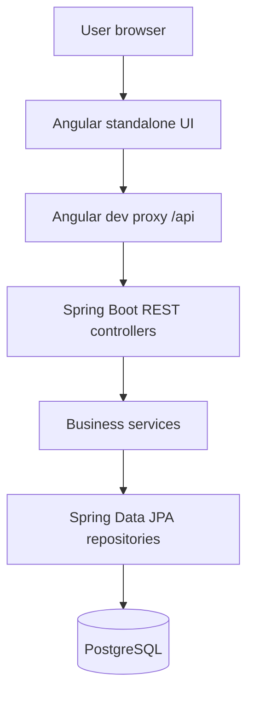
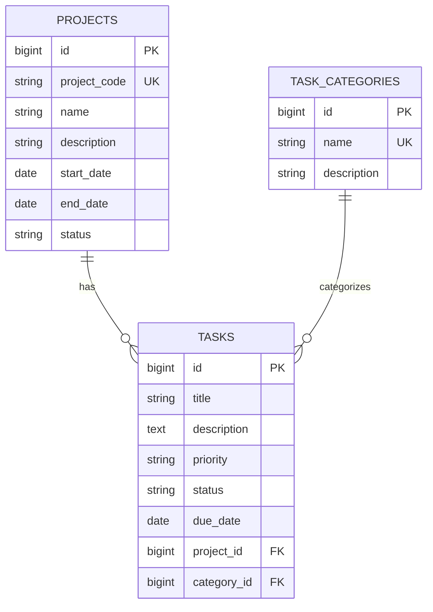

# Architecture & Data Model

## System overview

### Frontend

- `app.routes.ts`: lazy-loaded dashboard/projects/tasks/categories routes.
- `features/dashboard`: filtered overview and derived statistics using Angular Signals.
- `features/projects`, `features/tasks`, `features/categories`: list/form/details interfaces.
- `core/services`: Angular `HttpClient` API clients.
- `models`: TypeScript types and enums.
- `shared/management.css`: shared feature styling.
- Angular Reactive Forms provide form state and client-side validation.

**Dashboard behavior:** the reviewed dashboard fetches all task pages in batches (`size=5`) and computes totals in the browser. This is suitable for a small demo dataset; for large datasets, dedicated backend aggregate endpoints would be more scalable.

### Backend

- **Controller:** defines REST endpoints and HTTP responses.
- **DTO:** request validation and task response shape.
- **Service:** business rules, CRUD, transaction boundaries, filtering.
- **Repository:** JPA database access.
- **Entity:** persistence mapping.
- **Exception handler:** converts selected exceptions to JSON error responses.

## Entity relationship diagram

JPA uses `@ManyToOne(fetch = LAZY, optional = false)` for task→project and task→category. The relationship is mandatory for tasks. Project code and category name are unique at the database level. The `TaskResponse` DTO includes `projectName` and `categoryName` so the UI need not render nested JPA entities.

## Request flow example

1. User opens `/tasks/new` and completes a Reactive Form.
2. Angular TaskService sends `POST /api/tasks`.
3. `TaskController` validates the `TaskRequest` (`@Valid`).
4. `TaskService` loads referenced Project/Category, saves Task via JPA and returns a `TaskResponse`.
5. Angular updates the view or shows an API error.

## Key enums

- Project: `PLANNED`, `IN_PROGRESS`, `COMPLETED`, `ON_HOLD`.
- Task: `PENDING`, `IN_PROGRESS`, `COMPLETED`.
- Priority: `LOW`, `MEDIUM`, `HIGH`.

## Boundaries and trade-offs

The code reviewed is a **single-user-style demo**: no login, roles or access-control layer was identified. There is no verified production deployment, migrations framework, audit log, notification system or automated API documentation generator. Database schema updates currently rely on Hibernate `ddl-auto=update`. The frontend dev proxy is for local development, not a reverse-proxy production configuration.
